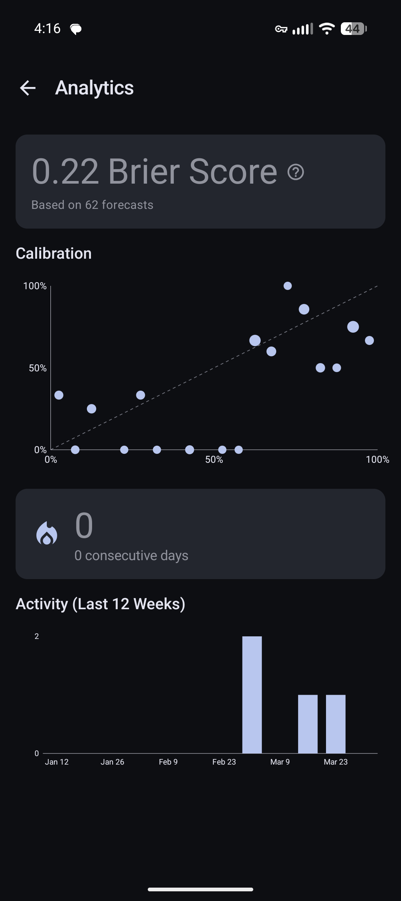
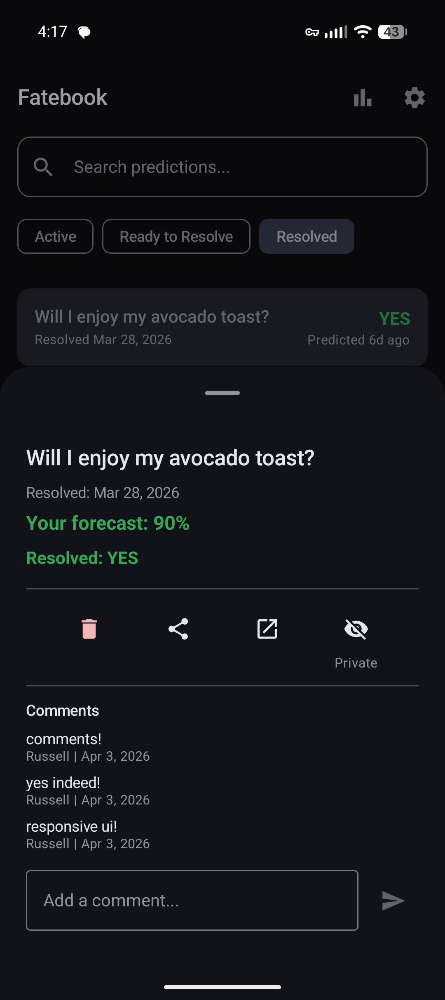
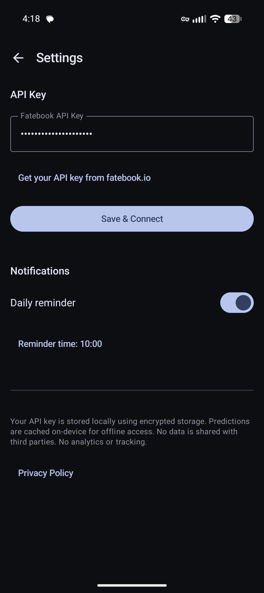

# Fatebook for Android

An unofficial Android client for [Fatebook](https://fatebook.io), the prediction-tracking platform. Built to make daily prediction logging frictionless on mobile.

<table>
  <tr>
    <td></td>
    <td></td>
    <td></td>
    <td></td>
  </tr>
</table>

## Features

- **Question feed** — filterable list (Active / Ready to Resolve / Resolved) with pull-to-refresh, search, shimmer loading, and infinite-scroll pagination
- **Quick create** — title, resolve-by date picker, probability slider with quick-set chips (10/25/50/75/90%)
- **Question detail sheet** — tap any card to view details, forecast, resolution, and comments. Includes edit, delete, share, open-in-browser, and public/private visibility toggle
- **Resolve flow** — YES / NO / Ambiguous buttons for questions past their resolve date
- **Update forecasts** — slider in the detail sheet to revise your probability on active questions
- **Comments** — view and add comments on any question, synced from the API and persisted in Room
- **Analytics** — total forecasts, Brier score, prediction streak, calibration chart, and an 11-week activity heatmap
- **Notifications** — two independent channels: a daily reminder (always fires) and a ready-to-resolve alert (fires when overdue questions exist)
- **Offline-first** — Room cache shows questions immediately; background API sync
- **Material You** — dynamic color theming on Android 12+, dark mode support

<table>
  <tr>
    <td></td>
    <td></td>
    <td></td>
  </tr>
</table>

## Install

1. Add `https://github.com/JapanColorado/fatebook-android` in [Obtainium](https://github.com/ImranR98/Obtainium) to install it and get updates automatically (every push to `main` that passes CI publishes a signed release), or download the APK from [GitHub Releases](https://github.com/JapanColorado/fatebook-android/releases/latest) and open it on your device
2. Get your API key at [fatebook.io/api-setup](https://fatebook.io/api-setup)
3. Open the app → Settings → paste the key → Save & Connect

## Building

### Prerequisites

- [pixi](https://pixi.sh) package manager
- Android SDK at `~/Android/Sdk`
- Android phone with USB debugging enabled

### Build & Install

```bash
pixi install           # Install JDK + Gradle via pixi
pixi run build         # Build release APK (signed if keystore.properties exists, else debug-signed)
pixi run install       # Build + install release APK on the connected device
pixi run run           # Install + launch
pixi run build-debug / install-debug / run-debug   # Debug variants (dev.russell.fatebook.debug)
pixi run logs          # Logcat for the running app
```

> Do not run `./gradlew` directly — the system only has a JRE. pixi provides the full JDK.

### Testing

```bash
pixi run test                   # JVM unit tests
pixi run test-all               # Unit tests + screenshot verify
pixi run test-screenshot-record # Regenerate Paparazzi golden images
pixi run test-screenshot-verify # Verify against golden images
pixi run lint                   # Lint checks
```

Unit tests use JUnit + MockK + Turbine + Truth. Screenshot tests use [Paparazzi](https://github.com/cashapp/paparazzi) to render Compose UI on JVM — no emulator needed.

## Architecture

MVVM + Repository pattern, offline-first.

```
Fatebook REST API → FatebookApi (Retrofit) → QuestionRepository → Room DB
                                                                 ↕
                                                              ViewModels → Compose UI
```

## Tech Stack

Kotlin, Jetpack Compose, Hilt, Retrofit + Moshi, Room, WorkManager, DataStore, EncryptedSharedPreferences

## License

Personal project. Not affiliated with Fatebook/Sage.
